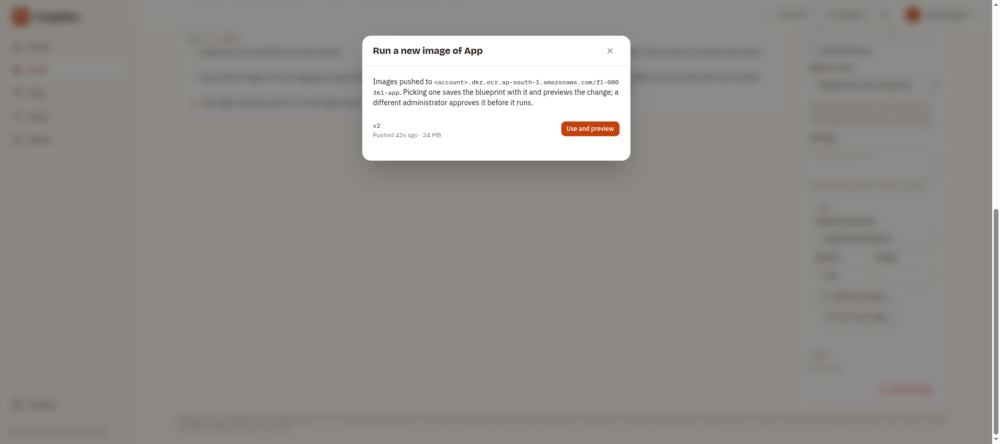

# Run a new image on real AWS, 2026-11-16

The real check of **Run a new image…** (#139, [note 040](../design/040-any-resource-any-cloud.md) step 4) on the
maintainer's Raspberry Pi Forgeline, with OpenTofu 1.13.9 and the Pi's AWS role. Account numbers are masked. Changes
were filed by `claude-agent` and approved with the server token, as the maintainer allows for Claude's own tests.

## Steps

1. A blueprint with one app block (`nginx:1.29`, one task on Fargate Spot, no front door) whose code is in a GitHub
   repository. Previewed (14 to add, including the block's ECR repository and push role), sent and approved: 14 added.
2. `GET .../blocks/app/images` right after: the block's repository, no images, `current` = `nginx:1.29`.
3. From the Pi, an amd64 `nginx:1.29-alpine` tagged `v2` pushed to that repository (a temporary Docker login, removed
   afterwards). The same call then listed it: tag `v2`, its digest, the push time and 24 MB.
4. In the console as `claude-agent`: the app block showed **Run a new image…**; the dialog listed `v2`, pushed 42 seconds
   before. **Use and preview** saved the blueprint (the image field now the repository's `:v2`) and started the preview:
   1 to add, 1 to change, 1 to remove (a new task definition, the service moved to it, the old one removed),
   guardrails had nothing to report.
5. Sent for approval from the console and approved: `Applied: 1 added, 1 changed, 1 removed`. ECS then reported the
   deployment `PRIMARY COMPLETED` with one task `RUNNING` on `FARGATE_SPOT`, image
   `<account>.dkr.ecr.ap-south-1.amazonaws.com/fl-080361-app:v2`, digest `sha256:a556523f…7b102020c`: the pushed one.
6. Opened again, the dialog marked `v2` **running now**.
7. Refused on the real server with 400: `nginx:1.29-alpine`, and the same registry with a repository name one letter
   longer (`…/fl-080361-appx:v2`).
8. Removed everything in one approved step (14 removed); the blueprint deleted. AWS then listed no cluster, ECR
   repository, IAM role or log group for it.

## What this shows

- The image list is a real ECR read through the blueprint's account connection, newest first, with the running image
  marked.
- Picking an image is one click to a ready preview, and the image runs only after a different principal approves it.
- Only the block's own repository is accepted.

## Not checked

- An image pushed by GitHub Actions or by a Forgeline build step. The image here was pushed by hand; how it got there
  does not change what the list reads.
- An agent block or a Lambda template block. Both use the same code path, covered by unit tests only.

## Which repository fits a block (#141, same day)

On the Pi, with the real GitHub App and the 18 repositories on its allow list, read as `claude-agent`:

- An app block on port 8080 named after a `web` folder: five suggestions, best first. The top one was a `web` folder
  whose Dockerfile listens on port 80 (said so: "Listens on port 80; … is set to 8080"), with its name and language
  (Node.js) as reasons. The others were top-level and service folders with other ports, and a worker with no port. No
  repository could not be read.
- An agent block and a Lambda function block: no suggestions. None of the repositories installs the AgentCore or
  Strands SDK or starts from a Lambda base image, and a folder that fits nothing is not offered.
- In the console, on a draft blueprint (no AWS involved), **Suggest a repository…** listed the same folders with their
  reasons. **Use** filled in the repository, an empty branch (main) and the folder, and the canvas showed "Not saved".
  The draft was deleted afterwards.

The repository names are the maintainer's and are left out here.
